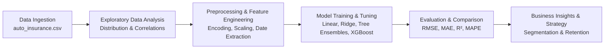

# 🚗 Auto Insurance Customer Lifetime Value (CLV) Prediction

[](https://www.python.org/)
[](https://jupyter.org/)
[](https://pandas.pydata.org/)
[](https://scikit-learn.org/)
[](LICENSE)

An end-to-end machine learning regression project to predict **Customer Lifetime Value (CLV)** in the auto insurance industry. By accurately estimating the total revenue or value a policyholder generates over their relationship with the firm, insurers can optimize customer acquisition costs (CAC), refine retention and loyalty strategies, and tailor personalized policy offerings.

---

## 📌 Table of Contents

- [Business Objective](#-business-objective)
- [Dataset Overview](#-dataset-overview)
- [Feature Architecture](#-feature-architecture)
- [Exploratory Data Analysis & Key Insights](#-exploratory-data-analysis--key-insights)
- [Modeling Workflow](#-modeling-workflow)
- [Project Structure](#-project-structure)
- [Getting Started](#-getting-started)
- [Business Implications](#-business-implications)
- [Contributing & License](#-contributing--license)

---

## 🎯 Business Objective

Customer Lifetime Value (CLV) represents the projected financial value of a customer throughout their entire engagement with an insurer. In the auto insurance domain, predicting CLV helps solve key operational and strategic challenges:

1. **Targeted Retention:** Identify high-value customers at risk of churn to proactively offer retention incentives.
2. **Optimized Marketing Spend:** Allocate acquisition budgets toward customer segments with high anticipated lifetime value.
3. **Personalized Policy Recommendations:** Offer dynamic coverage options (`Basic`, `Extended`, `Premium`) and targeted renewal offers.
4. **Profitability & Risk Alignment:** Balance policy premiums against claim frequencies and severity to protect margins.

---

## 📊 Dataset Overview

The dataset (`auto_insurance.csv`) comprises **9,134 customer records** and **24 distinct attributes**, capturing customer demographics, vehicle characteristics, policy specifics, and claims activity.

| Metric | Value |
| :--- | :--- |
| **Total Observations** | 9,134 |
| **Total Features** | 24 (23 predictors + 1 target) |
| **Missing Values** | 0 (100% complete) |
| **Duplicate Rows** | 0 |
| **Target Variable** | `Customer Lifetime Value` |
| **Target Distribution** | Min: \$1,898.01 \| Median: \$5,780.18 \| Mean: \$8,004.94 \| Max: \$83,325.38 |

---

## 🏗 Feature Architecture

Features are logically organized into five functional domains:

```
Data Features (24)
├── Target Variable
│   └── Customer Lifetime Value (continuous float, USD)
├── Customer Demographics
│   ├── State (Washington, Arizona, Nevada, California, Oregon)
│   ├── Education (High School or Below, College, Bachelor, Master, Doctor)
│   ├── EmploymentStatus (Employed, Unemployed, Medical Leave, Disabled, Retired)
│   ├── Gender (M, F)
│   ├── Income (Annual income; 2,317 entries with 0 income for Unemployed)
│   └── Marital Status (Single, Married, Divorced)
├── Policy & Coverage
│   ├── Coverage (Basic, Extended, Premium)
│   ├── Policy Type (Corporate Auto, Personal Auto, Special Auto)
│   ├── Policy (Corporate/Personal/Special L1, L2, L3 tiers)
│   ├── Number of Policies (1 to 9)
│   ├── Monthly Premium Auto (Monthly premium paid)
│   ├── Months Since Policy Inception (Policy tenure in months)
│   └── Effective To Date (Policy start/renewal date)
├── Claims & Service History
│   ├── Months Since Last Claim (0 to 35 months)
│   ├── Number of Open Complaints (0 to 5)
│   └── Total Claim Amount (Cumulative claims cost)
└── Marketing & Vehicle Attributes
    ├── Response (Customer response to marketing campaigns: Yes / No)
    ├── Renew Offer Type (Offer1, Offer2, Offer3, Offer4)
    ├── Sales Channel (Agent, Call Center, Branch, Web)
    ├── Vehicle Class (Four-Door Car, Two-Door Car, SUV, Sports Car, Luxury SUV, Luxury Car)
    └── Vehicle Size (Small, Medsize, Large)
```

---

## 🔍 Exploratory Data Analysis & Key Insights

1. **Target Distribution (Right-Skewed):**
   - The target `Customer Lifetime Value` is heavily right-skewed with a prominent tail of ultra-high-value policyholders (up to \$83k+).
   - *Modeling strategy:* Applying a logarithmic transformation ($\log(1 + y)$) normalizes residual variance and stabilizes linear regression estimates.

2. **Income & Employment Dynamics:**
   - 2,317 customers have an income of 0, primarily tied to the `Unemployed` status.
   - Multi-policy holders with stable employment display significantly higher aggregate CLV.

3. **Premium & Policy Multipliers:**
   - `Monthly Premium Auto` and `Number of Policies` serve as primary linear drivers of CLV.
   - Policyholders with premium coverage on luxury or SUV vehicle classes demonstrate elevated total claim amounts alongside higher lifetime premiums.

---

## ⚙️ Modeling Workflow

The project follows a standard machine learning lifecycle:



### 1. Data Preprocessing & Feature Engineering
- **Date Parsing:** Deconstruct `Effective To Date` into month, day, and day-of-week signals.
- **Categorical Encoding:**
  - *Ordinal Encoding* for ranked categories: `Coverage` (Basic < Extended < Premium), `Education`, `Vehicle Size`.
  - *One-Hot Encoding* for nominal categories: `State`, `EmploymentStatus`, `Marital Status`, `Policy Type`, `Renew Offer Type`, `Sales Channel`, `Vehicle Class`.
- **Feature Scaling:** `StandardScaler` / `RobustScaler` applied to continuous numerical features (`Income`, `Monthly Premium Auto`, `Total Claim Amount`).
- **Target Transformation:** $\log(1 + y)$ transformation to handle positive skewness.

### 2. Candidate Algorithms
- **Baselines:** Ordinary Least Squares (OLS) Linear Regression
- **Regularized Linear Models:** Ridge Regression ($L_2$), Lasso Regression ($L_1$), ElasticNet
- **Tree Ensembles:** Random Forest Regressor, Gradient Boosting Regressor
- **Gradient Boosted Trees:** XGBoost / LightGBM

### 3. Evaluation Metrics
Models are evaluated on hold-out test sets using:
- **$R^2$ Score** (Goodness of fit)
- **RMSE** (Root Mean Squared Error)
- **MAE** (Mean Absolute Error)
- **MAPE** (Mean Absolute Percentage Error)

---

## 📁 Project Structure

```
customer_lifetime_value_regression/
│
├── auto_insurance.csv               # Raw dataset (9,134 samples, 24 columns)
├── customer_lifetime_value.ipynb   # Jupyter notebook with EDA, transformations, and modeling
├── requirements.txt                 # Python dependencies
└── README.md                        # Project documentation & reference guide
```

---

## 🚀 Getting Started

### Prerequisites

Ensure you have Python 3.9+ installed on your system.

### 1. Clone the Repository

```bash
git clone git@github.com:devloopcode/customer_lifetime_value_regression.git
cd customer_lifetime_value_regression
```

### 2. Create and Activate a Virtual Environment

```bash
# Using venv
python3 -m venv venv
source venv/bin/activate  # On Windows: venv\Scripts\activate
```

### 3. Install Dependencies

```bash
pip install -r requirements.txt
```

### 4. Launch Jupyter Notebook

```bash
jupyter notebook customer_lifetime_value.ipynb
# or
jupyter lab
```

---

## 💼 Business Implications

- **Value-Tier Segmentation:** Insurers can group customers into Platinum, Gold, Silver, and Bronze tiers based on projected CLV to allocate dedicated account managers or concierge claims handling.
- **Dynamic Renewal Offers:** Tailor renewal offers (`Offer1` through `Offer4`) based on channel responsiveness (`Agent`, `Branch`, `Call Center`, `Web`) to maximize renewal rates.
- **Churn Mitigation:** High-CLV customers filing open complaints can trigger automated prioritization flags for customer support.

---

## 👤 Author

- **Mohamed Idbenouakrim** - [@devloopcode](https://github.com/devloopcode)

---

## 📄 License

This project is open-source and available under the [MIT License](LICENSE).