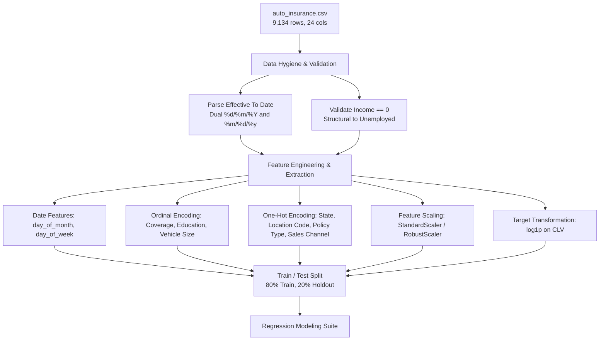

# 🚗 Auto Insurance Customer Lifetime Value (CLV) Prediction

[](https://www.python.org/)
[](https://jupyter.org/)
[](https://pandas.pydata.org/)
[](https://scikit-learn.org/)
[](https://xgboost.readthedocs.io/)
[](LICENSE)

An end-to-end machine learning regression project to predict **Customer Lifetime Value (CLV)** in the auto insurance domain. By accurately forecasting the financial value of each policyholder, insurance providers can strategically optimize customer acquisition costs (CAC), allocate retention resources toward high-value tiers, personalize cross-selling and policy upgrades, and protect underwriting margins.

---

## 📌 Table of Contents

- [Business Objective](#-business-objective)
- [Dataset Overview](#-dataset-overview)
- [Summary Statistics](#-summary-statistics)
- [Feature Architecture](#-feature-architecture)
- [Exploratory Data Analysis & Critical Data Discoveries](#-exploratory-data-analysis--critical-data-discoveries)
  - [1. Dual Date-Format Inconsistency & Resolution](#1-dual-date-format-inconsistency--resolution)
  - [2. Structural Zero-Income & Employment Status](#2-structural-zero-income--employment-status)
  - [3. Target Variable Skewness (CLV)](#3-target-variable-skewness-clv)
  - [4. Primary Linear Correlates & Drivers](#4-primary-linear-correlates--drivers)
- [Data Preprocessing & Feature Engineering](#-data-preprocessing--feature-engineering)
- [Candidate Regression Models](#-candidate-regression-models)
- [Project Structure](#-project-structure)
- [Getting Started](#-getting-started)
- [Strategic Business Applications](#-strategic-business-applications)
- [Author & License](#-author--license)

---

## 🎯 Business Objective

Customer Lifetime Value (CLV) estimates the cumulative revenue generated by a policyholder over their tenure minus the costs associated with servicing and claims. In auto insurance, estimating CLV presents several key strategic opportunities:

1. **Precision Retention Marketing:** Identify high-CLV customers approaching policy renewal or experiencing service friction to offer targeted loyalty discounts and concierge claims support.
2. **Customer Acquisition Cost (CAC) Optimization:** Calibrate marketing spend across acquisition channels (`Agent`, `Branch`, `Call Center`, `Web`) based on predicted lifetime value rather than single-term premiums.
3. **Personalized Policy Recommendations:** Recommend tiered coverage options (`Basic`, `Extended`, `Premium`) and tailored endorsement packages to accounts with high growth potential.
4. **Underwriting & Risk-Value Alignment:** Assess whether elevated premium revenues sufficiently offset high cumulative claim amounts across various vehicle classes and regional territories.

---

## 📊 Dataset Overview

The dataset ([auto_insurance.csv](auto_insurance.csv)) contains **9,134 records** across **24 attributes** detailing customer demographics, vehicle categories, policy characteristics, and claims activity.

| Dataset Metric | Detail |
| :--- | :--- |
| **Total Observations** | 9,134 |
| **Total Attributes** | 24 (1 Identifier + 22 Features + 1 Target) |
| **Target Variable** | `Customer Lifetime Value` (Continuous USD) |
| **Missing Values** | 0 (100% complete across all columns) |
| **Duplicate Records** | 0 |
| **Observation Window** | January 1, 2011 to February 28, 2011 (59 consecutive days) |

---

## 📈 Summary Statistics

Transposed summary statistics for all numerical features in the dataset:

| Feature | Mean | Std Dev | Min | 25% | Median (50%) | 75% | Max |
| :--- | :---: | :---: | :---: | :---: | :---: | :---: | :---: |
| **Customer Lifetime Value** | \$8,004.94 | \$6,870.97 | \$1,898.01 | \$3,994.25 | \$5,780.18 | \$8,962.17 | \$83,325.38 |
| **Income** | \$37,657.38 | \$30,379.90 | \$0.00 | \$0.00 | \$33,889.50 | \$62,320.00 | \$99,981.00 |
| **Monthly Premium Auto** | \$93.22 | \$34.41 | \$61.00 | \$68.00 | \$83.00 | \$109.00 | \$298.00 |
| **Months Since Last Claim** | 15.10 | 10.07 | 0.00 | 6.00 | 14.00 | 23.00 | 35.00 |
| **Months Since Policy Inception** | 48.06 | 27.91 | 0.00 | 24.00 | 48.00 | 71.00 | 99.00 |
| **Number of Open Complaints** | 0.38 | 0.91 | 0.00 | 0.00 | 0.00 | 0.00 | 5.00 |
| **Number of Policies** | 2.97 | 2.39 | 1.00 | 1.00 | 2.00 | 4.00 | 9.00 |
| **Total Claim Amount** | \$434.09 | \$290.50 | \$0.10 | \$272.26 | \$383.95 | \$547.51 | \$2,893.24 |

---

## 🏗 Feature Architecture

The dataset's 24 attributes are categorized into six functional domains:

```
Dataset Schema (24 Attributes)
├── Identifier
│   └── Customer (Unique policyholder ID, e.g. BU79786)
├── Target Variable
│   └── Customer Lifetime Value (Continuous float, USD)
├── Demographics & Geography
│   ├── State (Washington, Arizona, Nevada, California, Oregon)
│   ├── Location Code (Suburban [5,779], Rural [1,773], Urban [1,582])
│   ├── Education (High School or Below, College, Bachelor, Master, Doctor)
│   ├── EmploymentStatus (Employed, Unemployed, Medical Leave, Disabled, Retired)
│   ├── Gender (F [4,658], M [4,476])
│   ├── Income (Annual income; range $0 to $99,981)
│   └── Marital Status (Married [5,298], Single [2,467], Divorced [1,369])
├── Policy & Coverage Specifics
│   ├── Coverage (Basic, Extended, Premium)
│   ├── Policy Type (Personal Auto, Corporate Auto, Special Auto)
│   ├── Policy (Corporate/Personal/Special sub-tiers L1, L2, L3)
│   ├── Number of Policies (1 to 9 policies held)
│   ├── Monthly Premium Auto ($61 to $298)
│   ├── Months Since Policy Inception (0 to 99 months)
│   └── Effective To Date (Mixed-format policy date; Jan 1 – Feb 28, 2011)
├── Claims & Service History
│   ├── Months Since Last Claim (0 to 35 months)
│   ├── Number of Open Complaints (0 to 5 complaints)
│   └── Total Claim Amount (Cumulative claim payouts, $0.10 to $2,893.24)
└── Marketing & Vehicle Attributes
    ├── Response (Campaign engagement: No [7,826], Yes [1,308])
    ├── Renew Offer Type (Offer1, Offer2, Offer3, Offer4)
    ├── Sales Channel (Agent, Branch, Call Center, Web)
    ├── Vehicle Class (Four-Door Car, Two-Door Car, SUV, Sports Car, Luxury SUV, Luxury Car)
    └── Vehicle Size (Small, Medsize, Large)
```

---

## 🔍 Exploratory Data Analysis & Critical Data Discoveries

During exploratory data analysis in [`customer_lifetime_value.ipynb`](customer_lifetime_value.ipynb), several foundational data anomalies and structural characteristics were uncovered:

### 1. Dual Date-Format Inconsistency & Resolution

A common data ingestion pitfall exists within `Effective To Date`. Naive parsing with `pd.to_datetime()` produces a false 12-month spread (January 2011 to December 2011) due to two distinct year encoding styles:

- **2-digit year format (`%m/%d/%y`):** 5,467 records (e.g. `1/13/11`, `2/28/11`), strictly covering **January 13, 2011 to February 28, 2011**.
- **4-digit year format (`%d/%m/%Y`):** 3,667 records (e.g. `10/2/2011`, `12/2/2011`). When correctly parsed as Day/Month/Year instead of Month/Day/Year, these represent February 10 and February 12, covering **January 1, 2011 to February 12, 2011**.

```python
# Discovered in customer_lifetime_value.ipynb:
raw_date = df["Effective To Date"]
year_len = raw_date.str.split("/").str[2].str.len()
long_mask = year_len == 4

df["Effective To Date (parsed)"] = pd.NaT
df.loc[long_mask, "Effective To Date (parsed)"] = pd.to_datetime(raw_date[long_mask], format="%d/%m/%Y")
df.loc[~long_mask, "Effective To Date (parsed)"] = pd.to_datetime(raw_date[~long_mask], format="%m/%d/%y")
```

> **Validation:** Once parsed with dual formats, 100% of rows resolve into a contiguous **59-day observation period** from **2011-01-01** to **2011-02-28** with zero missing dates and zero NaT entries.

### 2. Structural Zero-Income & Employment Status

- Exactly **2,317 rows (25.37%)** contain `Income == 0`.
- Cross-tabulation reveals an exact **1:1 mapping with `EmploymentStatus == 'Unemployed'`**:

| Employment Status | Income == 0 (True) | Income > 0 (False) |
| :--- | :---: | :---: |
| **Unemployed** | **2,317** | 0 |
| **Employed** | 0 | 5,698 |
| **Medical Leave** | 0 | 432 |
| **Disabled** | 0 | 405 |
| **Retired** | 0 | 282 |

> **Key Modeling Takeaway:** Zero income is a genuine economic reality, **not missing data**. It must not be imputed with mean or median values. For customers with active income, the average income is **\$50,456.58** (median: \$48,081, range: \$10,037 to \$99,981).

### 3. Target Variable Skewness (CLV)

- The target variable `Customer Lifetime Value` exhibits significant positive right-skewness:
  - 50% of policyholders have CLV under **\$5,780.18**.
  - The mean is **\$8,004.94**, pulled upward by high-value outliers up to **\$83,325.38**.
- **Transformation Strategy:** A logarithmic transformation ($\log(y)$ or $\log(1 + y)$) is applied for linear models to stabilize variance and achieve normal residual distributions, with inverse exponential re-transformation (`np.expm1`) applied for final metric reporting.

### 4. Primary Linear Correlates & Drivers

| Feature | Correlation with CLV ($r$) | Insight |
| :--- | :---: | :--- |
| `Monthly Premium Auto` | **+0.396** | Primary direct driver; higher base monthly premium compounds over tenure. |
| `Total Claim Amount` | **+0.226** | Strong positive association; higher total claims reflect longer tenure or multi-vehicle coverage. |
| `Income` | +0.024 | Weak linear correlation across the whole population due to the zero-income cluster. |
| `Number of Policies` | +0.022 | Non-linear multiplier requiring interaction features. |
| `Number of Open Complaints` | -0.036 | Negative correlation; dissatisfaction often signals churn or lower cumulative tenure. |

---

## ⚙️ Data Preprocessing & Feature Engineering



1. **Date Deconstruction:**
   - Extract `effective_day`, `effective_dayofweek`, and `is_weekend` from the validated date column.
2. **Identifier Handling:**
   - Drop `Customer` ID from training features to prevent memorization.
3. **Categorical Encoding:**
   - **Ordinal Encoding:**
     - `Coverage`: `Basic` (0) < `Extended` (1) < `Premium` (2)
     - `Education`: `High School or Below` (0) < `College` (1) < `Bachelor` (2) < `Master` (3) < `Doctor` (4)
     - `Vehicle Size`: `Small` (0) < `Medsize` (1) < `Large` (2)
   - **One-Hot Encoding:**
     - `State`, `Location Code`, `EmploymentStatus`, `Gender`, `Marital Status`, `Policy Type`, `Policy`, `Renew Offer Type`, `Sales Channel`, `Vehicle Class`, `Response`.
4. **Numerical Transformations:**
   - `RobustScaler` / `StandardScaler` for `Monthly Premium Auto`, `Total Claim Amount`, and `Income`.
   - Log transformation $\log(1 + y)$ on `Customer Lifetime Value`.

---

## 🤖 Candidate Regression Models

The modeling suite evaluates baseline, regularized, and tree-based architectures:

| Algorithm Family | Candidate Models | Rationale |
| :--- | :--- | :--- |
| **Linear Baselines** | Ordinary Least Squares (OLS) | Establish baseline linear interpretability. |
| **Regularized Linear** | Ridge ($L_2$), Lasso ($L_1$), ElasticNet | Penalize collinearity between policy and premium features. |
| **Ensemble Trees** | Random Forest Regressor, Extra Trees | Capture non-linear policy count and vehicle size interactions. |
| **Gradient Boosting** | XGBoost, LightGBM, CatBoost | Optimized gradient boosting with custom loss and handling for skewed targets. |

### Evaluation Metrics

All models are benchmarked across standard continuous evaluation metrics:
- **$R^2$ Score (Coefficient of Determination):** Proportion of variance explained by model features.
- **Root Mean Squared Error (RMSE):** Penalizes large prediction errors in dollars.
- **Mean Absolute Error (MAE):** Average magnitude of errors in original currency units (\$ USD).
- **Mean Absolute Percentage Error (MAPE):** Percentage accuracy relative to actual CLV values.

---

## 📁 Project Structure

```
customer_lifetime_value_regression/
│
├── auto_insurance.csv               # Raw dataset (9,134 records, 24 attributes)
├── customer_lifetime_value.ipynb   # Exploratory Data Analysis, date repair, feature profiling
├── requirements.txt                 # Project environment dependencies
└── README.md                        # Project documentation and engineering reference
```

---

## 🚀 Getting Started

### Prerequisites

- Python 3.9 or higher
- `pip` or `conda`

### 1. Clone the Repository

```bash
git clone git@github.com:devloopcode/customer_lifetime_value_regression.git
cd customer_lifetime_value_regression
```

### 2. Environment Setup

```bash
# Using Python venv
python3 -m venv venv
source venv/bin/activate  # On Windows: venv\Scripts\activate

# Install required packages
pip install -r requirements.txt
```

### 3. Run the Jupyter Notebook

```bash
jupyter notebook customer_lifetime_value.ipynb
# or
jupyter lab
```

---

## 💼 Strategic Business Applications

- **Tiered VIP Services:** Group customers into Diamond (\$15k+), Platinum (\$10k–\$15k), Gold (\$6k–\$10k), and Standard (< \$6k) tiers based on predicted CLV to prioritize customer support queues and dedicated claim adjusters.
- **Dynamic Renewal Offers:** Target specific renew offer types (`Offer1` through `Offer4`) based on channel receptivity and high projected CLV to boost contract renewal rates.
- **Proactive Churn Intervention:** Automatically flag high-value policyholders filing complaints (`Number of Open Complaints > 0`) for executive concierge resolution.
- **Channel Allocation:** Redirect marketing budgets toward sales channels (`Agent`, `Branch`, `Web`, `Call Center`) that consistently yield higher average lifetime customer value.

---

## 👤 Author

- **Mohamed Idbenouakrim** - [@devloopcode](https://github.com/devloopcode)

---

## 📄 License

This project is licensed under the [MIT License](LICENSE).